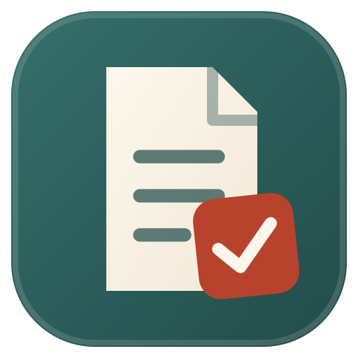
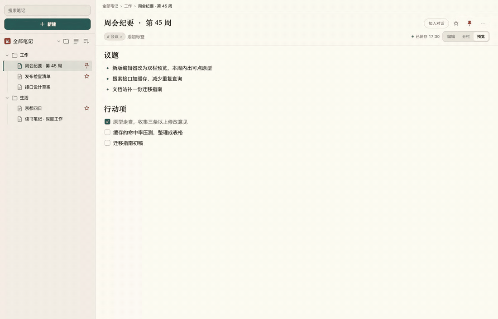
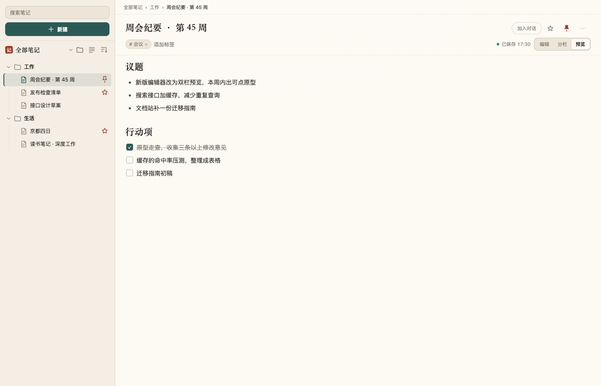
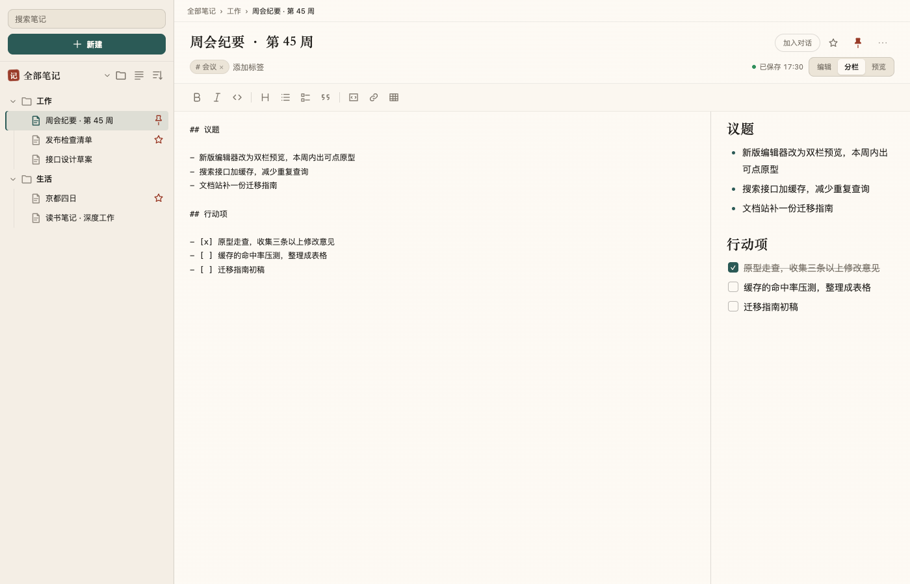
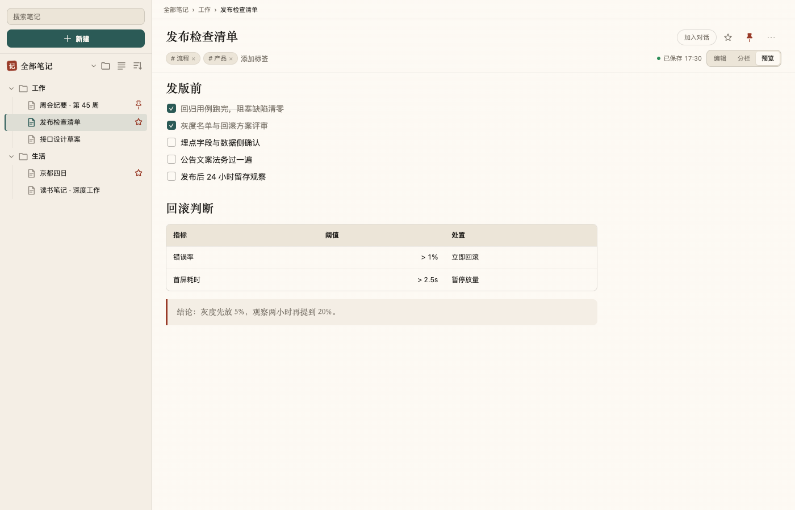
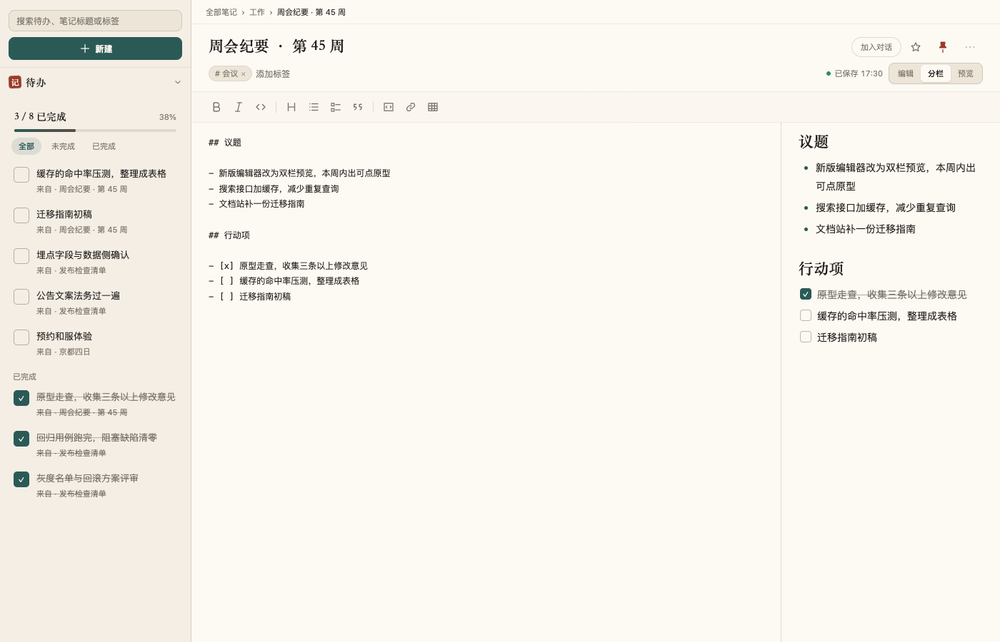
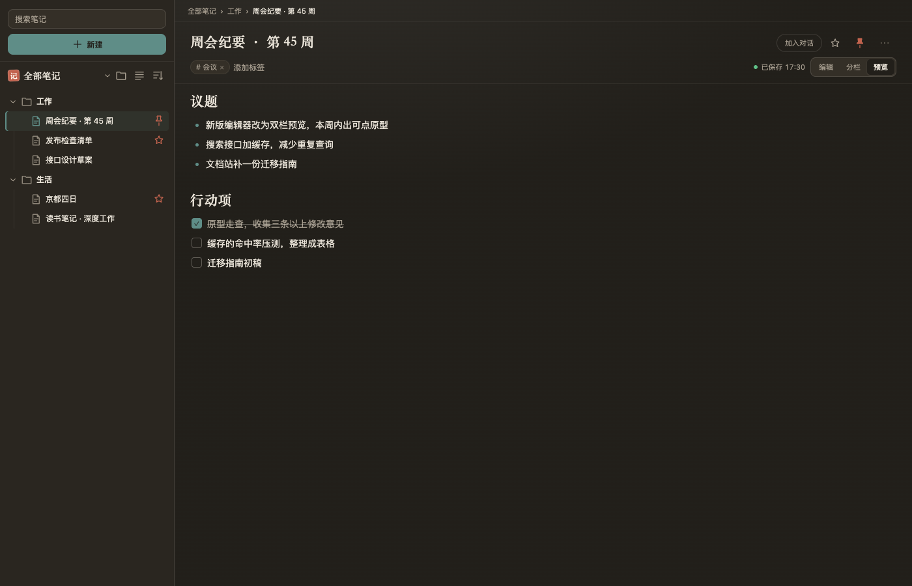
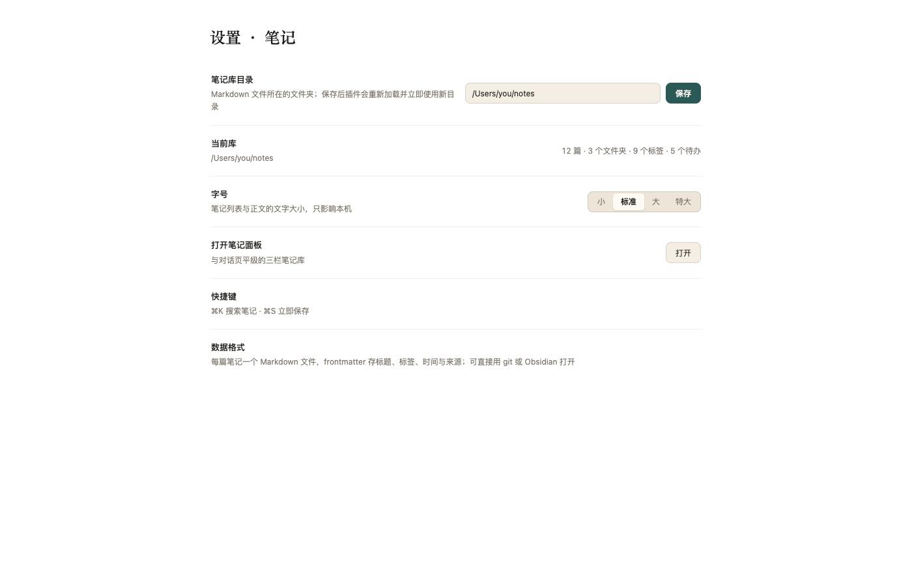

<div align="center">



# dsh-note

**Your notes stay in your folder. Your thinking stays beside the conversation.**

A local-first Markdown notebook inside [DeepSeek Harness](https://github.com/deepseek-ai): a switchable vault view, split live preview, an aggregated todo centre, and a two-way bridge between conversations and notes.

[](https://github.com/SivanCola/dsh-note/actions/workflows/test.yml) [](LICENSE) [](package.json) [](#data--privacy)

[Install](#install) · [Features](docs/features.en.md) · [简体中文](README.md)

</div>

<p align="center">
  
</p>

<p align="center"><sub>Fictional sample notes only · no real data</sub></p>

## Why dsh-note

**Local-first, not locked in.** No account, no cloud, no telemetry. One note is one `.md` file; the vault is a folder you can keep in git, open in Obsidian, or edit in any editor. Uninstall the plugin and the notes are still there.

**Grows with the conversation.** Deposit a session as a dated note, save an assistant answer into a note, insert a note or a selection into the draft, and follow sources in both directions. It is not a copy of the chat log — it is long-term memory you can search and cite.

**Write, read, find.** Folder tree, live preview, full-text search, tags and a todo centre live in one panel. No jumping between an editor, a file manager and the chat window.

## Screenshots

| Vault and view switcher | Split edit / live preview |
| --- | --- |
|  |  |

| Tables, checkboxes and quotes | Todo centre |
| --- | --- |
|  |  |

| Dark mode | Settings · Notes |
| --- | --- |
|  |  |

## Core features

| Write | Organise | Connect |
| --- | --- | --- |
| **Vault and view switcher**<br>Recent / All notes / Starred / Tags / Todos live in the list-header menu; real folder tree, single-line titles, breadcrumbs; arrow keys and Home / End. | **Search, tags and favourites**<br>⌘K full-text search with highlights; tags grouped by frequency; favourites and pins stored separately. | **Session deposit**<br>Turn the current session into a dated note tagged `会话沉淀`. |
| **Split live preview**<br>Markdown renders as you type; drag the divider or nudge it with the keyboard; the ratio is remembered. | **Todo centre**<br>Every `- [ ]` in the vault with progress and status filters; ticking writes back to the file. | **Sources and links**<br>Save an answer into a note; add a note to a conversation; jump both ways. |

The right sidebar also carries a **Workspace notes** card: a compact list scoped to the current workspace folder, with reading in place and a jump back to the full panel when you want to edit. When the folder is absent, the empty state offers All notes instead of forcing the whole vault into a narrow pane.

## Install

```sh
dsh plugin add github:SivanCola/dsh-note
```

After installing, confirm that "Notes" is enabled on the plugins page and open the notes panel (a list and an editor in two panes) from the sidebar, or open **Workspace notes** from the right sidebar. The first open creates `notes/` under Harness's default working directory.

For local development, install the repository directory as a bundle with `plugin_manager` (`install_bundle`). Because it is a directory link, disable and re-enable "Notes" on the plugins page to reload after editing, refreshing the page if needed.

## Data & privacy

- The default vault is `<Harness default working directory>/notes`. Override it with `DSH_NOTES_DIR` or `Settings → Notes` (the plugin reloads and applies the new directory immediately).
- One note is one Markdown file. Frontmatter stores the title, tags, timestamps and sources. Open it with git, Obsidian or any editor.
- UI preferences (text size, sort, reading mode, split ratio) live in this machine's `localStorage`; they do not travel with the vault.
- The plugin only reads and writes local files. No account, cloud sync or telemetry.

<details>
<summary>What does a note look like?</summary>

```markdown
---
title: Double 11 lucky wheel — API review
tags: [campaign, api]
created: 2026-11-09T03:34:19.511Z
updated: 2026-11-09T03:35:23.241Z
pinned: false
starred: false
---

## Background
...
```

A note id is its path relative to the vault, without `.md`, for example `work/2026/api-review`. The tree mirrors real folders on disk; renaming the title never renames the file.

</details>

## Docs

- [Feature guide](docs/features.en.md): behaviour and limits, data format, HTTP API, implementation and verification
- [简体中文 README](README.md)
- [MIT License](LICENSE)

## Development

```sh
npm run check   # syntax check
npm test        # 22 tests
```

No build step and no third-party runtime dependencies. Tests run in temporary directories and never touch a real vault; GitHub Actions runs the same checks on Node 22 / 24.

## Roadmap

`[[wiki links]]` and a knowledge base, moving / renaming folders, web clipping, AI summaries and continuation, Youdao Cloud Notes sync, daily-journal templates.

---

<sub>Screenshots and the demo use the plugin's real stylesheet with fictional sample notes; no real data is shown.</sub>
