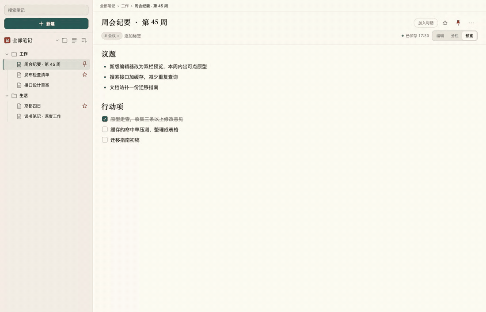
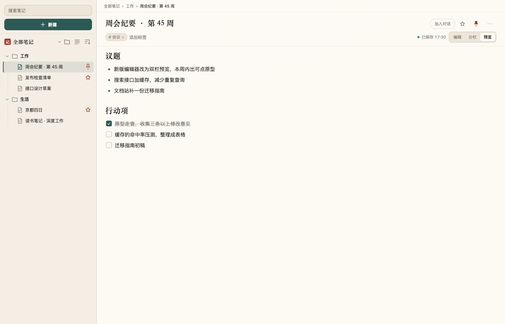
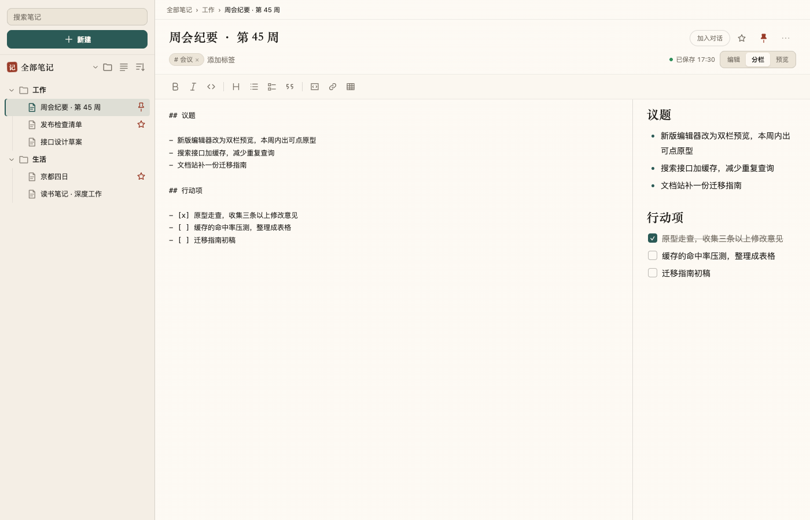
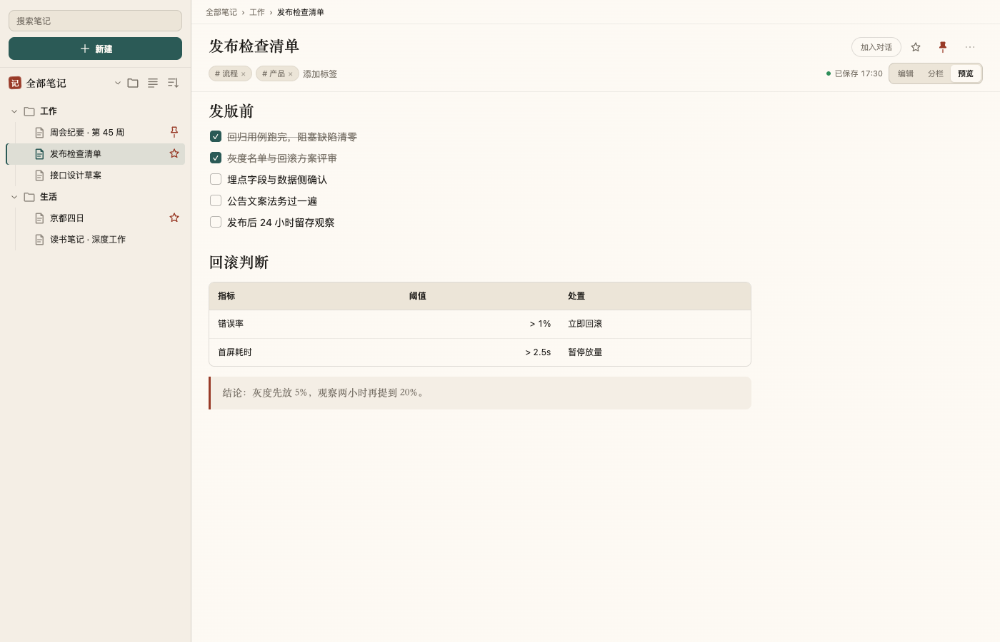
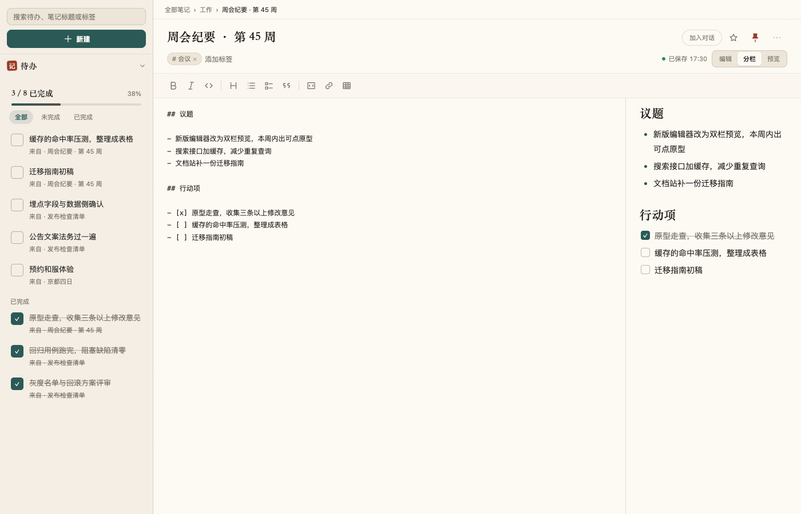
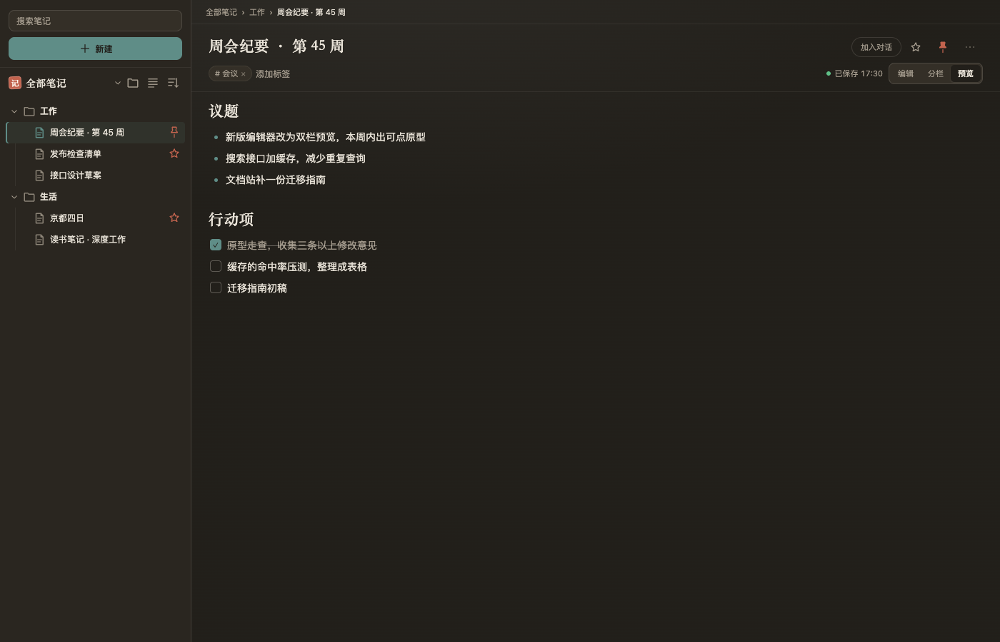
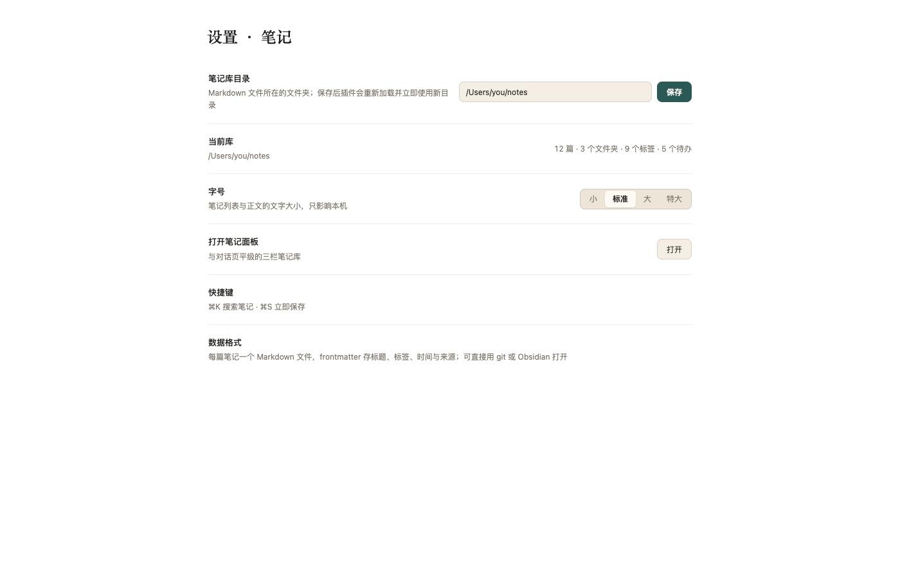

<div align="center">


# dsh-note

**笔记留在自己的文件夹里，灵感留在对话旁边。**

一个装在 [DeepSeek Harness](https://github.com/deepseek-ai) 里的本地 Markdown 笔记应用：可切换视图的笔记库、分栏实时预览、待办中心，以及「对话 ↔ 笔记」的双向流转。

[](https://github.com/SivanCola/dsh-note/actions/workflows/test.yml) [](LICENSE) [](package.json) [](#数据与隐私)

[安装](#安装) · [功能详解](docs/features.md) · [English](README.en.md)

</div>

<p align="center">
  
</p>

<p align="center"><sub>示例数据均为虚构 · 不使用任何真实笔记</sub></p>

## 为什么是 dsh-note

**本地优先，不被锁定。** 没有账号、没有云端、没有遥测。一篇笔记就是一个 `.md` 文件，整个库就是一个文件夹——可以用 git 管、用 Obsidian 开、用任何编辑器改。卸载插件，笔记还在。

**和对话长在一起。** 会话可以一键沉淀成笔记，回答可以存进笔记，笔记或选中的片段可以加入对话草稿，来源与关联可以双向跳转。不是把聊天记录复制出去，而是让它变成能被搜索和引用的长期记忆。

**写、读、找一条龙。** 目录树、实时预览、全文搜索、标签、待办中心都在同一个面板里。不用在编辑器、文件管理器和聊天窗口之间来回切。

## 界面预览

| 笔记库与视图切换 | 分栏编辑 / 实时预览 |
| --- | --- |
|  |  |

| 表格、复选框与引用 | 待办中心 |
| --- | --- |
|  |  |

| 深色模式 | 设置 · 笔记 |
| --- | --- |
|  |  |

## 核心功能

| 写作 | 整理 | 连接 |
| --- | --- | --- |
| **笔记库与视图切换**<br>最近 / 全部笔记 / 收藏 / 标签 / 待办收进列表头的菜单；真实文件夹树、单行标题、面包屑；方向键与 Home / End 导航。 | **搜索、标签与收藏**<br>⌘K 全文搜索并高亮命中；标签按频次聚合；收藏与置顶独立保存。 | **会话沉淀**<br>把当前会话整理成带日期的笔记，自动打上「会话沉淀」标签。 |
| **分栏实时预览**<br>Markdown 边写边渲染；分隔条可拖动，也支持键盘微调；比例自动记住。 | **待办中心**<br>聚合全库 `- [ ]`，显示进度、按状态筛选；勾选回写原文件。 | **来源与关联**<br>回答存进笔记；笔记加入对话；来源与关联双向跳转。 |

右侧栏里还有一张「工作区笔记」卡片：按当前会话的工作区文件夹收一份紧凑列表，点开就能读；需要编辑时再跳回完整面板。找不到对应文件夹时会给出空状态和「查看全部笔记」，不会把整库硬塞进窄栏。

## 安装

```sh
dsh plugin add github:SivanCola/dsh-note
```

安装后在插件页确认「笔记」已启用，从侧栏打开笔记面板（列表 + 编辑器两栏），或在右侧栏打开「工作区笔记」。首次打开会在 Harness 的默认工作目录下创建 `notes/`。

也可以把仓库目录装成本地 bundle 进行开发：在 DSH 里用 `plugin_manager` 的 `install_bundle`；因为装的是目录链接，改完代码后在插件页停用再启用「笔记」即可重新载入，必要时刷新页面。

## 数据与隐私

- 默认库目录是 `<Harness 默认工作目录>/notes`，也可以用环境变量 `DSH_NOTES_DIR`，或在 `设置 → 笔记` 里改目录（保存后插件自动重载）。
- 一篇笔记一个 Markdown 文件，frontmatter 保存标题、标签、时间与来源；可以直接用 git 或 Obsidian 打开。
- 界面偏好（字号、排序、阅读模式、分栏比例）只保存在本机 `localStorage`，不随库同步。
- 插件只在本机读写文件；没有账号、云端同步或遥测。

<details>
<summary>一篇笔记长什么样？</summary>

```markdown
---
title: 双十一广告转盘活动 · 接口评审
tags: [活动, 接口]
created: 2026-11-09T03:34:19.511Z
updated: 2026-11-09T03:35:23.241Z
pinned: false
starred: false
---

## 背景
...
```

笔记 id 是相对库目录的文件路径去掉 `.md`，例如 `工作/2026/接口评审`。目录树对应磁盘上的真实子文件夹；改标题不会重命名文件。

</details>

## 文档

- [功能详解](docs/features.md)：每个功能的边界、数据格式、HTTP API、实现方式与验证方式
- [English README](README.en.md)
- [MIT License](LICENSE)

## 开发

```sh
npm run check   # 语法检查
npm test        # 22 个测试
```

零构建、零第三方运行时依赖。测试在临时目录执行，不会修改真实笔记库；GitHub Actions 在 Node 22 / 24 上运行同样的检查。

## 路线图

`[[双链]]` 与知识库、文件夹移动 / 重命名、网页剪藏、AI 摘要与续写、有道云笔记同步、每日日记模板。

---

<sub>界面预览与动图按插件真实样式渲染，示例笔记均为虚构。</sub>
